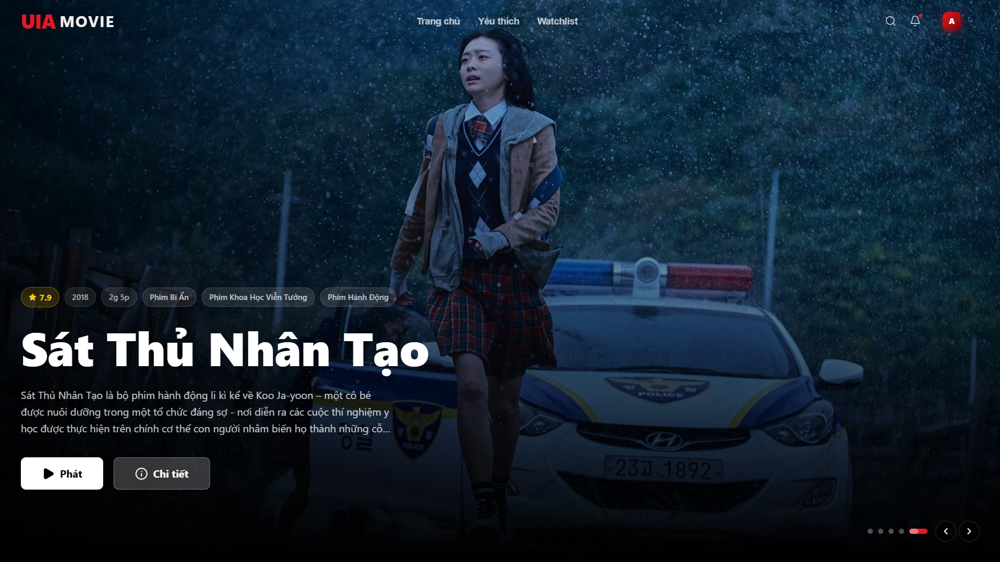
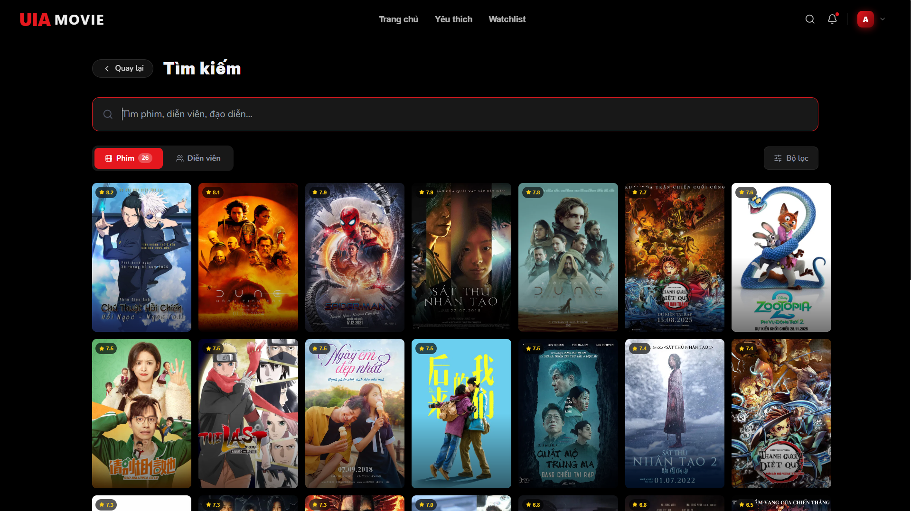
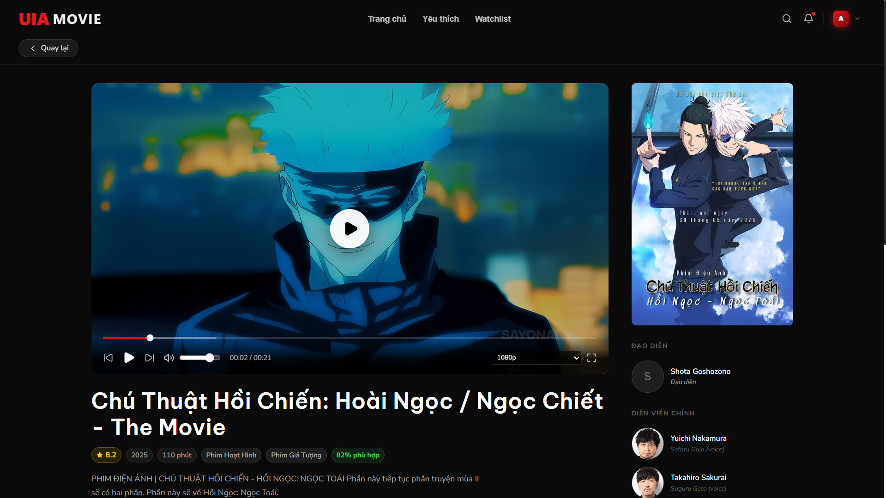
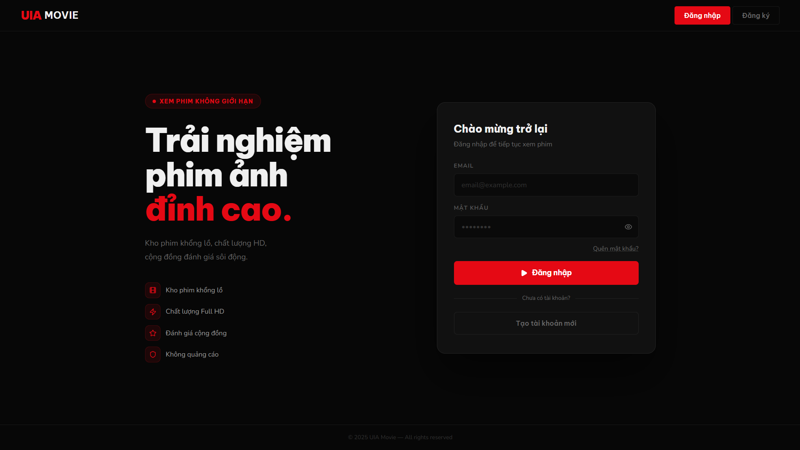
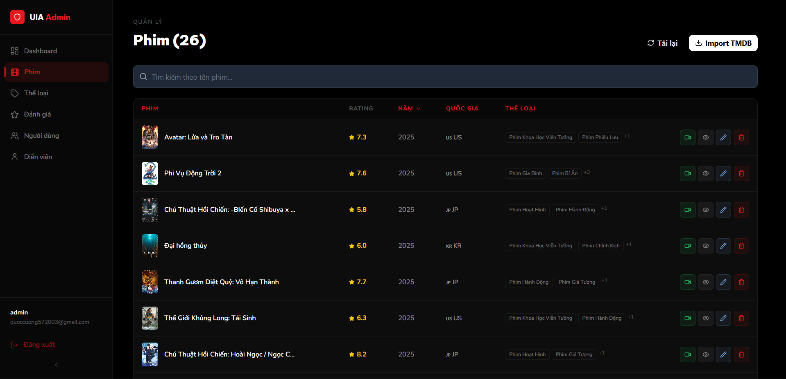

<div align="center">

# 🎬 UIA Movie

### A Netflix-inspired Movie Streaming Platform — Built with React 19 & Framer Motion

<br/>


<br/>

> A full-featured, production-ready movie streaming UI with dark cinema aesthetics,
> smooth animations, and a complete admin dashboard — all powered by a RESTful .NET backend.

</div>

---

## 🌐 Live Demo

| Resource | URL |
|---|---|
| 🖥️ **Frontend** | `https://uiamovie.vercel.app` |
| ⚙️ **Backend API** | `http://localhost:5000/api` |

> **Note:** The backend is self-hosted. Clone and run locally for full functionality.

---

## 📖 Overview

**UIA Movie** is a Netflix-style movie streaming frontend built entirely in React. It delivers a cinematic, dark-luxury browsing experience with fluid animations, a rich discovery system, and a complete admin control panel.

The app connects to a custom **.NET 8 REST API** backed by a SQL database and TMDB integration, allowing real movie data — posters, cast, descriptions, trailers — to be imported and served dynamically.

Whether you're a user browsing the latest K-Drama or an admin importing films from TMDB and managing users, UIA Movie has you covered.

---

## ✨ Features

### 🔐 Authentication
- Email/password login & registration (email OTP confirmation) with live form validation
- **Two-Factor Authentication (2FA)** via OTP email
- Forgot password → OTP reset flow
- JWT access token held **in memory only**; refresh token lives in an **HttpOnly cookie** and is renewed silently (single-flight refresh, see [Token Strategy](#token-strategy))
- Protected routes with role-based access (`User` / `Admin`)
- **Banned accounts** see the ban banner (with reason) on the login form; editing the email or password clears it so the user can try another account right away
- Shared validation rules (mirrored by the backend):
  - Email: valid format, max **254** characters
  - Password: 8+ characters with upper, lower, digit and special (`!@#$%^&*`), max **72 bytes** (BCrypt limit)
  - Username: 3–50 characters, letters / digits / `_` only (`src/utils/validators.js`, also used on the Profile page)
- Changing the password signs the user out of every device and sends them back to `/welcome`

### 🏠 Home & Discovery
- **Auto-playing HeroBanner** slideshow (5 slides, 6s interval) with cinematic transitions
- **Genre section** — horizontally scrollable cards with backdrop images and hover effects
- **Top 10 Today** ranked row with large numbered overlays
- **Country-based rows** — KR 🇰🇷 / CN 🇨🇳 / US 🇺🇸 / JP 🇯🇵 with per-country accent colors
- **"For You" recommendations** — genre-frequency engine based on personal watch history
- **Newly Released** & **Highly Rated** movie rows with smooth carousel navigation

### 🔍 Search & Filtering
- Real-time search for movies and actors in a unified interface
- Tab switching between **Movies** and **Actors** results
- Multi-filter panel: genre, release year, country, sort order, minimum rating slider
- Active filter chips with individual removal
- Actor cards with profile photos navigating to full person pages

### 🎬 Movie Detail
- Full detail page with backdrop hero, cast scroll row, genre badges, and runtime
- Integrated **review & rating system** — write, edit, delete your own reviews
- Rating statistics with star distribution breakdown
- Related cast cards that link to individual person profile pages
- TMDB-sourced cast, director bio, known-for filmography

### 💎 Premium & Payments
- **Premium page** (`/premium`) with Free / Monthly (69,000 ₫) / Yearly (599,000 ₫, ~27.7% cheaper) plans, benefits and FAQ. Feature lists match the backend: Full HD / 4K, no ads, offline download, priority support (yearly)
- **Two gateways**: the user picks **VNPay** (redirect) or **SePay** (hidden `form_post` built from the `formFields` the backend returns, in the original order). `paymentService.redirectToPayment(order)` handles both
- **Confirm-before-order checkout**: clicking a plan only opens a confirmation dialog (plan, price, gateway). The order (`POST /payments/create-order`) is created **only when the user presses "Thanh toán"**, so an accidental click and "Quay lại" never leaves a `pending` order behind (and if the user does create several orders, the backend keeps only the newest one open). The dialog is closable with Esc / backdrop click until the request is sent, locks body scroll, and keeps the button locked after a successful order so a double-click cannot create two orders
- **Back-from-gateway recovery**: when the browser restores the page from the back/forward cache, a `pageshow` handler clears the stuck spinner, closes the dialog, shows a "payment not completed" hint and silently refreshes the subscription status
- **No "reload flash"** when coming back to `/premium`: the subscription status is cached at module level (stale-while-revalidate), the plan cards' entrance animation plays only once per session, and the Google-Fonts `<style>` tag is injected once and kept
- **Renewal is allowed while Premium is active** — the backend adds the new period on top of the current expiry date. Paid cards show "Gia hạn" instead of "Bắt đầu ngay"
- **Payment result page** (`/payment/result`) does **not** trust the `status` query parameter; it looks the order up by `orderCode` in the payment history to confirm the real result
- **Cancel Premium** from the Profile page: access ends immediately and the remaining time is **not refunded** (the confirmation modal and FAQ say so)
- Subscription info on Profile is read from `GET /payments/subscription-status`, not from `User.SubscriptionType`, so it always matches what the paywall enforces
- There is no money-back guarantee and no free trial; the UI no longer advertises either

### 👤 User Profile & Account
- Editable display name (same rules as registration)
- Avatar: **preview only** for now. Local `blob:` URLs are neither sent to the API nor written to `localStorage`; real avatar upload needs a backend endpoint (see [Future Improvements](#-future-improvements))
- **Favorites** list — add/remove from any card or detail page
- **Watch History** — time-stamped, clearable individually or in bulk
- **Security settings** — change password, enable/disable 2FA

### 🛡️ Admin Dashboard
- **Stats overview** — total movies, genres, users, trending count
- **Movie management** — search, edit, delete, and manage video files
- **TMDB import tool** — search TMDB and one-click import with conflict detection
- **Video upload panel** — drag-and-drop upload to Cloudinary with real-time progress, cancel support, and quality/type selection
- **Genre CRUD** — create, edit, delete genres with color-coded cards
- **Review moderation** — browse and delete reviews per film
- **User management** — view details, edit username/avatar, change role, ban / unban with reason, delete. Premium is granted or revoked through the payment endpoints (`adminGrantSubscription` / `adminRevokeSubscription`), not by editing `subscriptionType`
- **Revenue dashboard** (`AdminRevenue`) backed by `AdminRevenueController`:
  - KPI cards: total revenue (with average order value), **today**, this month (with month-over-month growth, hidden when last month is 0), active Premium users (and how many expire within 7 days), pending orders, and success rate (with failed vs expired counts)
  - Revenue chart by month or by day, revenue by plan, and a filterable order table (status, plan, gateway, e-mail / order-code search, **created-date range**) paged with the shared `AdminPagination`
  - **Export Excel** (`GET /payments/admin/revenue/export`) uses the current status / plan / gateway / date filters (the search box is not applied). With no status selected only successful orders are exported; successful orders are filtered by **paid date**, all others by **created date**; the backend caps the file at 50,000 rows and returns a readable message when it is exceeded
  - **Time zone**: every date and month is Vietnam time (GMT+7). The UI sends plain `yyyy-MM-dd` dates (inclusive of the last day), computes the default year/month in GMT+7 instead of the browser zone, and renders the UTC timestamps the API returns as Vietnam time
- Collapsible sidebar navigation

### 📱 Responsive Design
- Mobile-first breakpoints via `useIsMobile` hook (< 768px)
- 2-column grid on mobile, auto-fill on desktop
- Touch-friendly scroll rows with `scroll-snap`
- Adaptive HeroBanner height, font sizes, and button sizing

---

## 🛠️ Tech Stack

| Category | Technology |
|---|---|
| **Framework** | React 19 |
| **Build Tool** | Vite 8 |
| **Routing** | React Router DOM v7 |
| **Animations** | Framer Motion 12 |
| **Styling** | Tailwind CSS 3 + Inline design tokens |
| **HTTP Client** | Axios 1.x with request/response interceptors, `withCredentials` for the refresh cookie |
| **Session state** | `useSyncExternalStore` over `sessionStore` (profile) + `tokenStore` (access token) |
| **Payments** | VNPay + SePay (via backend) |
| **Icons** | Lucide React |
| **Deployment** | Vercel (SPA rewrite configured) |
| **External Data** | TMDB API (via backend proxy) |
| **Media Storage** | Cloudinary (video upload) |

---

## 🎨 UI Highlights

UIA Movie is built around a **dark cinema aesthetic** — deep blacks, subtle grain texture overlays, and carefully tuned color accents.

### Design System
- **Color tokens** defined in `homeTokens.js` and `searchConstants.jsx` — a single source of truth for background, surface, accent (`#e5181e`), gold (`#f5c518`), and typography colors
- **Two typefaces**: `Be Vietnam Pro` (display/headings) + `Nunito` (body/UI)
- Consistent `border-radius`, spacing, and shadow scales across all components

### Animation Philosophy
- All transitions use **Framer Motion** with curated easing curves from `transitions.js`
- Card hover: scale + translateY + shadow elevation
- Page elements: staggered `opacity + y` entrance animations
- HeroBanner: crossfade backdrop + slide content with directional awareness
- Modals: spring-based scale-in from center
- Sidebar: animated width collapse (220px ↔ 64px)

### Scroll & Navigation UX
- Horizontal scroll rows with **fade edge masks** and **ghost nav arrows** (appear on row hover)
- Scroll-snap on mobile for card rows
- `ScrollToTop` component resets position on every route change
- Sticky filter bar with `backdrop-filter: blur`

---

## 🔌 API Integration

All API communication goes through a centralized **Axios instance** (`src/config/axios.js`):

```
Base URL: http://localhost:5000/api/
```

### Token Strategy
- The **access token lives only in memory** (`config/tokenStore.js`); it is never written to `localStorage`. An old `accessToken` key left by earlier versions is removed on load
- The **refresh token is an HttpOnly cookie** set by the backend (`withCredentials: true`); JavaScript can never read it
- `config/sessionStore.js` is the only place that reads/writes the display profile (`currentUser`) in `localStorage`. It also marks "has ever signed in" and syncs across tabs through the `storage` event
- **Bootstrap:** on app start the UI renders immediately from the stored profile while a background refresh fetches an access token. Requests that need a token wait for it; guests make no network call
- **Single-flight refresh:** concurrent callers share one promise; across tabs a **Web Lock** (`uiamovie-refresh-token`) prevents two tabs from rotating the same cookie
- **Transient failures** (network, timeout, 429, 5xx) trigger a 5 s cooldown and keep the session; only a real `401` (or a missing token in the response) clears it. A `403` (origin not whitelisted) never logs the user out
- Public auth endpoints (`login`, `register`, `otp`, `forgot-password`, `reset-password`, `refresh-token`) skip the bootstrap wait and the 401-refresh logic
- On a `401` the interceptor refreshes once and replays the request; if refresh fails with an auth error the session is cleared and the user is sent to `/welcome`
- Cross-tab sync: signing out in one tab drops the token in the others; signing in elsewhere lets this tab pick up a token on its next request
- `getFreshAccessToken()` serves non-Axios clients (SignalR, `fetch`) and refreshes when the token expires within 30 s
- The interceptor returns the response **body** (`{ data, message }`). Services therefore return `res.data` for data endpoints and `res` for message-only endpoints (update, role, ban, delete, change-password)
- Errors are read with `getApiErrorMessage` (`utils/apiError.js`), which understands both `{ message }` and ProblemDetails responses

### Service Modules

| Service | Responsibility |
|---|---|
| `authService.js` | Login, register, OTP, forgot/reset password, session management |
| `movieService.js` | Trending, search, by-genre, by-country, favorites, watch history, video progress |
| `genreService.js` | Genre CRUD |
| `personService.js` | Cast, person detail & images via TMDB proxy |
| `reviewService.js` | Movie reviews — create, edit, delete, stats, check-if-reviewed |
| `userService.js` | Own profile, change password, and admin user CRUD / role / ban / unban |
| `paymentService.js` | Plans, create order, `redirectToPayment` (VNPay redirect / SePay form post), subscription status, history, order lookup by code, cancel own Premium, admin grant / revoke, revenue summary / chart / by-plan, orders, and `adminExportRevenue` (Blob download) |

---

## 📁 Project Structure

```
src/
├── components/
│   ├── admin/          # Admin-only panels, modals, tables
│   │   ├── movie/      # MovieDetailPanel, VideoUploadPanel
│   │   └── user/       # UserDetailPanel, UserEditModal
│   ├── common/         # BackButton, Pagination, AdminPagination, SeeAllButton
│   ├── home/           # HeroBanner, GenreSection, MovieRow,
│   │   │               # TopRankedRow, CountryMovieRows, TrendingSection
│   ├── layout/         # Navbar, Footer
│   ├── movie/          # MovieCard, MovieCarousel, PersonScrollRow
│   ├── search/         # SearchBar, SearchTabs, FilterPanel,
│   │   │               # MovieCard (search), ActorCard, SearchUI
│   └── ui/             # Button, Input, Modal, Badge, Spinner, RatingStars
│
├── config/
│   ├── axios.js        # Axios instance, single-flight refresh, bootstrap
│   ├── tokenStore.js   # In-memory access token
│   └── sessionStore.js # Stored profile (localStorage) + cross-tab sync
│
├── context/
│   ├── homeTokens.js   # Global design tokens (colors, fonts, genre maps)
│   └── adminTokens.js  # Admin design tokens (used by AdminPagination, AdminRevenue)
│
├── hooks/
│   ├── useIsMobile.js  # Responsive breakpoint hook
│   ├── useStoredUser.js# Subscribes to sessionStore
│   └── usePagination.js# Client & server-side pagination hook
│
├── motion-configs/
│   ├── transitions.js  # Framer Motion timing presets
│   └── variants.js     # Reusable animation variants
│
├── pages/
│   ├── admin/          # AdminPage, AdminDashboard, AdminMovies,
│   │   │               # AdminGenres, AdminReviews, AdminUsers,
│   │   │               # AdminPersons, AdminTmdbSearch, AdminRevenue
│   └── user/           # HomePage, MovieDetailPage, MovieInfoPage,
│                       # SearchPage, BrowsePage, ProfilePage,
│                       # SecurityPage, FavoritesPage, WatchHistoryPage,
│                       # PersonPage, LandingPage,
│                       # PremiumPage, PaymentResultPage
│
├── router/
│   └── AppRouter.jsx   # BrowserRouter + protected/guest routes
│
├── utils/
│   ├── apiError.js     # getApiErrorMessage
│   └── validators.js   # validateUsername (shared by register + profile)
│
└── services/           # authService, movieService, genreService,
                        # personService, reviewService,
                        # userService, paymentService
```

---

## 🚀 Installation & Setup

### Prerequisites
- Node.js ≥ 18
- The backend API running at `http://localhost:5000`

### Steps

```bash
# 1. Clone the repository
git clone https://github.com/your-username/uia-movie.git
cd uia-movie

# 2. Install dependencies
npm install

# 3. Configure environment (see section below)
cp .env.example .env

# 4. Start the development server
npm run dev
```

The app will be available at `http://localhost:5173`.

### Build for Production

```bash
npm run build
npm run preview
```

---

## ⚙️ Environment Variables

Create a `.env` file at the project root:

```env
# Backend API base URL
VITE_API_URL=http://localhost:5000/api
```

> The Axios instance reads from `VITE_API_URL` at build time (a trailing `/` is normalised).
> For Vercel deployments, add this variable in the Vercel project settings and add the Vercel domain to the backend's `Cors:AllowedOrigins`; otherwise `/auth/refresh-token` answers `403`.
> The refresh cookie is scoped to `/api/auth`, so any reverse proxy must forward `/api/*` unchanged.

---

## 📋 Usage

### As a Regular User
1. Navigate to `/welcome` — register or log in
2. Browse the home feed — trending, by country, top-rated, personalized rows
3. Click any movie to open the **detail page** — read info, watch trailer, write a review
4. Use the **Search** page to find movies or actors with advanced filters
5. Manage your **Favorites** and review your **Watch History** from the navbar
6. Update your profile or toggle 2FA under **Profile** / **Security Settings**
7. Open **/premium**, pick a plan, confirm it in the dialog and pay through VNPay or SePay (nothing is created until you press "Thanh toán"); you return to `/payment/result`, where the order is verified against your payment history
8. Manage the subscription under **Profile → Gói đăng ký** (renew from `/premium`, or cancel — access ends immediately, no refund)

### As an Admin
1. Log in with an Admin-role account — you will see an **Admin** link in the navbar
2. Use the **Dashboard** for a quick system overview
3. Go to **Movies → TMDB Search** to search and import new films
4. Upload video files from the **Movie Detail panel** with quality and type selection
5. Manage **Genres**, **Reviews**, **Users**, and **Persons** from the sidebar
6. Open **Revenue** to see KPIs, the revenue chart and the order list; filter by status / plan / gateway / date and press **Xuất Excel** for an accounting-ready `.xlsx`

---

## 📸 Screenshots

> *(Replace placeholders with actual screenshots)*

| Screen | Preview |
|---|---|
| 🏠 Home — Hero Banner |  |
| 🔍 Search with Filters |  |
| 🎬 Movie Detail |  |
| 👤 Login / Register |  |
| 🛡️ Admin Dashboard |  |

---

## 🔮 Future Improvements

- [ ] **Avatar upload** — needs a backend upload endpoint; today the avatar is preview-only
- [ ] **Show the current plan** — the backend does not yet store `planId` on a subscription, so no plan card can be marked "GÓI CỦA BẠN" (the hero badge still shows Premium status)
- [ ] **Checkout dialog accessibility** — focus trap and return focus to the plan button on close
- [ ] **Move the subscription-status cache into `paymentService`** and invalidate it on cancel / create-order, so `/premium` never shows a stale state for the first few hundred milliseconds
- [ ] **Remove the hidden SePay form** from the DOM after submitting it
- [ ] **Align Free-plan copy** (720p, 1 device) with what the backend actually enforces
- [ ] **Video Player** — integrate a full-featured HLS player with quality switching
- [ ] **Watchlist / Continue Watching** — resume from last position with progress bar
- [ ] **Notifications** — real-time alerts for new releases or admin actions
- [ ] **Dark / Light mode** — theme toggle preserving cinema feel in light mode
- [ ] **Infinite scroll** — replace pagination with virtual scroll on Browse page
- [ ] **Social features** — follow other users, see their watchlists
- [ ] **Offline support** — PWA with service worker caching for core UI
- [ ] **i18n** — full English / Vietnamese language toggle
- [ ] **Performance** — image lazy loading with blur-up placeholders, React.lazy code splitting per route
- [ ] **Testing** — Vitest unit tests for services and hooks; Playwright E2E for auth and browsing flows

---

## 👨‍💻 Author

**Quoc Cuong**
- Facebook: [gnoucdasick](https://www.facebook.com/gnoucdasick/)
- Email: [quoccuong572003@gmail.com](mailto:quoccuong572003@gmail.com)

---

## 📄 License

This project is licensed under the **MIT License** — see the [LICENSE](LICENSE) file for details.

---

<div align="center">

Made with ❤️ and a lot of ☕ — inspired by Netflix, built for learning.

**⭐ Star this repo if you found it useful!**

</div>