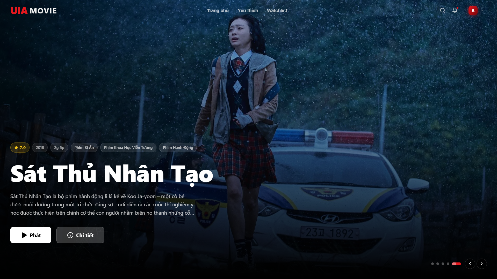
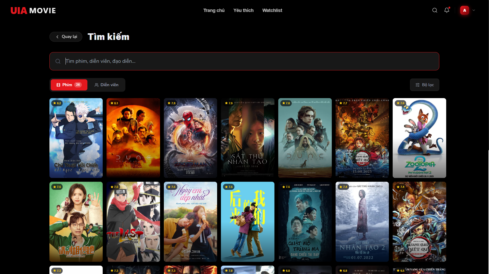
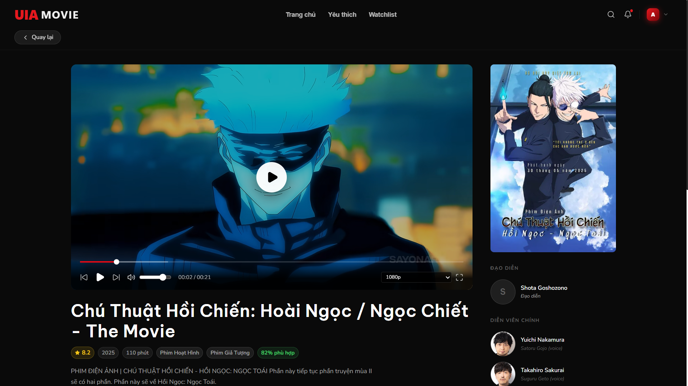
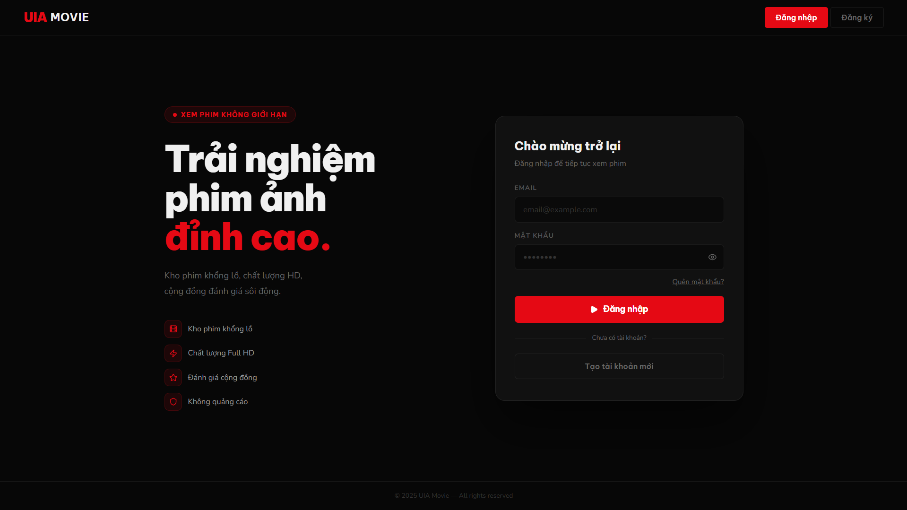
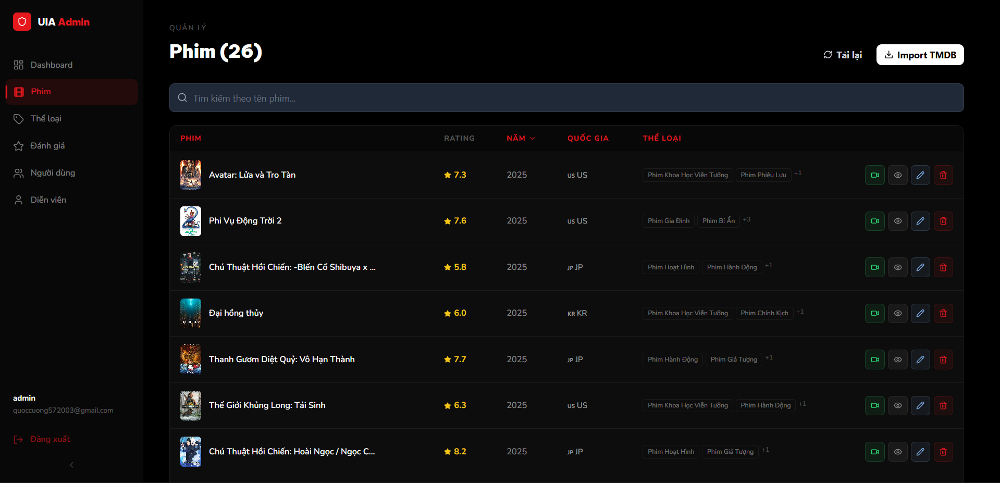

<div align="center">

# 🎬 UIA Movie

### A Netflix-inspired Movie Streaming Platform — Built with React 19 & Framer Motion

<br/>


<br/>

> A full-featured, production-ready movie streaming UI with dark cinema aesthetics,
> smooth animations, and a complete admin dashboard — all powered by a RESTful .NET backend.

</div>

---

## 🌐 Live Demo

| Resource | URL |
|---|---|
| 🖥️ **Frontend** | `https://uiamovie.vercel.app` |
| ⚙️ **Backend API** | `http://localhost:5000/api` |

> **Note:** The backend is self-hosted. Clone and run locally for full functionality.

---

## 📖 Overview

**UIA Movie** is a Netflix-style movie streaming frontend built entirely in React. It delivers a cinematic, dark-luxury browsing experience with fluid animations, a rich discovery system, and a complete admin control panel.

The app connects to a custom **.NET 8 REST API** backed by a SQL database and TMDB integration, allowing real movie data — posters, cast, descriptions, trailers — to be imported and served dynamically.

Whether you're a user browsing the latest K-Drama or an admin importing films from TMDB and managing users, UIA Movie has you covered.

---

## ✨ Features

### 🔐 Authentication
- Email/password login & registration (email OTP confirmation) with live form validation
- **Two-Factor Authentication (2FA)** via OTP email
- Forgot password → OTP reset flow
- JWT access token held **in memory only**; refresh token lives in an **HttpOnly cookie** and is renewed silently (single-flight refresh, see [Token Strategy](#token-strategy))
- Protected routes with role-based access (`User` / `Admin`)
- **Banned accounts** see the ban banner (with reason) on the login form; editing the email or password clears it so the user can try another account right away
- Shared validation rules (mirrored by the backend):
  - Email: valid format, max **254** characters
  - Password: 8+ characters with upper, lower, digit and special (`!@#$%^&*`), max **72 bytes** (BCrypt limit)
  - Username: 3–50 characters, letters / digits / `_` only (`src/utils/validators.js`, also used on the Profile page)
- Changing the password signs the user out of every device and sends them back to `/welcome`

### 🏠 Home & Discovery
- **Auto-playing HeroBanner** slideshow (5 slides, 6s interval) with cinematic transitions
- **Genre section** — horizontally scrollable cards with backdrop images and hover effects
- **Top 10 Today** ranked row with large numbered overlays
- **Country-based rows** — KR 🇰🇷 / CN 🇨🇳 / US 🇺🇸 / JP 🇯🇵 with per-country accent colors
- **"For You" recommendations** — genre-frequency engine based on personal watch history
- **Newly Released** & **Highly Rated** movie rows with smooth carousel navigation
- **Fast, staged loading**: only the trending list blocks the first paint (it feeds the Hero). Everything else streams in as it arrives; the two 100-item lists used below the fold load after the Hero, and each country row loads only when it is about to scroll into view
- **Instant return visits**: every section is cached (see [State Management](#-state-management--data-fetching)), so coming back to `/` renders immediately and refreshes in the background

### 🔍 Search, Browse & Filtering
- **Instant navbar search** (desktop dropdown / mobile full-screen overlay): movies, TV shows and actors in one panel
  - Three independent queries (movies, TV, actors) → the fast ones render first, the heavy actor lookup never blocks them
  - Debounced (220 ms, min. 2 characters); every new keystroke **aborts** the previous requests (`AbortSignal`), so a slow old response can never overwrite a newer one
  - **Stale-while-searching**: while a new term loads, the previous results stay on screen (dimmed) instead of flashing a skeleton; the shimmer only appears for the very first lookup
  - Results are cached per term for 5 min → deleting a character and typing it again is instant
  - Result rows use pure-CSS hover/entrance animations and `React.memo`, so hovering or typing re-renders almost nothing
- **Search page** (`/search`): Movies / TV Show tabs, URL-driven filters (genre, year, country, sort, min. rating), active filter chips, server-side pagination
- **Browse page** (`/browse`): same grid and animation pattern with a filter sidebar (desktop) / bottom sheet (mobile)
- Next-page **prefetch** + poster preloading on Search and Browse (same query key as the visible query, so the next click is instant)
- **Mobile**: floating pill bottom navigation (`MobileBottomNav`) with a sliding active indicator; the middle tab opens the search overlay

### 🎬 Movie Detail
- Full detail page with backdrop hero, cast scroll row, genre badges, and runtime
- Integrated **review & rating system** — write, edit, delete your own reviews
- Rating statistics with star distribution breakdown
- Related cast cards that link to individual person profile pages
- TMDB-sourced cast, director bio, known-for filmography

### 💎 Premium & Payments
- **Dynamic plans**: `/premium` renders whatever `GET /payments/plans` returns. Plans are configured by admins and nothing is hard-coded. Only the "Free" comparison card is static (`FREE_PLAN`)
- **Savings badges** are computed on the client: "Giảm X%" when `originalPriceVnd > priceVnd`, otherwise "Tiết kiệm X%" (per-month price versus the most expensive paid plan, shown only when the saving is ≥ 5%). Free/trial plans get a "Dùng thử" badge
- **Eligibility**: the plans request carries the access token, so the backend returns `isEligible` / `ineligibleReason` for every plan (trial already used, wrong e-mail domain, purchase limit reached, trial while Premium is active, plan no longer on sale). Ineligible cards are dimmed, show "Không khả dụng" and the reason
- **Plan metadata on the card**: strikethrough original price, `≈ price/month` hint for long plans (≥ 300 days), sale deadline (`endsAt`, "Ưu đãi đến …"), allowed e-mail domains (e.g. a student plan), description and feature list
- **Current plan marker**: `GET /payments/subscription-status` returns `planId` / `planName`, so the matching card shows "GÓI CỦA BẠN". Premium granted manually by an admin has `planId = null` and matches no card (the hero badge still shows the Premium status and expiry)
- **Free / trial plans (0đ)**: the checkout dialog hides the gateway picker and shows "Kích hoạt dùng thử". `create-order` answers `paymentMethod: "none"` (no URL, no redirect); the page refreshes the Premium status via `authService.refreshPremiumStatus()` and goes straight to `/payment/result`
- **Two gateways** for paid plans: **VNPay** (redirect) or **SePay** (hidden `form_post` built from the `formFields` the backend returns, in the original order). `paymentService.redirectToPayment(order)` handles both
- **Confirm-before-order checkout**: clicking a plan only opens a confirmation dialog (plan, price, gateway). The order (`POST /payments/create-order`) is created **only when the user presses "Thanh toán"**, so an accidental click and "Quay lại" never leaves a `pending` order behind. If the user does create several orders, the backend keeps only the newest one open (older ones become `cancelled`). The dialog closes with Esc / backdrop click until the request is sent, locks body scroll, and keeps the button locked after a successful order so a double-click cannot create two orders
- **Back-from-gateway recovery**: when the browser restores the page from the back/forward cache, a `pageshow` handler clears the stuck spinner, closes the dialog, shows a "payment not completed" hint and silently refreshes plans and subscription status
- **No "reload flash"** when coming back to `/premium`: plans and subscription status are cached at module level (stale-while-revalidate), the plan cards' entrance animation plays only once per session, and the Google-Fonts `<style>` tag is injected once and kept
- **Renewal is allowed while Premium is active** — the backend adds the new period on top of the current expiry date. Paid cards show "Gia hạn" instead of the plan's CTA (trial plans never show it) and a note with the current expiry date
- **Payment result page** (`/payment/result`) does **not** trust the `status` query parameter; it looks the order up by `orderCode` in the payment history to confirm the real result
- **Cancel Premium** from the Profile page: access ends immediately and the remaining time is **not refunded** (the confirmation modal and FAQ say so). Cancelling during a trial does not give the trial back
- Subscription info on Profile is read from `GET /payments/subscription-status`, not from `User.SubscriptionType`, so it always matches what the paywall enforces
- There is no money-back guarantee. Free trials exist only as plans an admin creates with price 0 (one use per account by default)
- **Design v4 ("soft")**: large radii, diffuse shadows, spring motion (`SPRING` / `SPRING_SOFT`), pill badges and a glow behind the featured block, with gradient dividers instead of ticket-style corners

### 📺 Advertising (Free users)
- Ads are shown to **Free** users only; Premium users skip them (the "no ads" benefit)
- **Single-video architecture**: the ad plays on the *same* `<video>` element as the movie. `useAdManager` swaps `src` for the ad and puts the movie back afterwards (seeking to the saved position), and `tryStartPreRoll()` runs synchronously inside the first Play gesture so iOS autoplay rules are respected
- **Pre-roll / mid-roll / post-roll**
  - Mid-rolls fire from `timeupdate`. If a resume or seek jumps past an offset, that ad is treated as missed (5 s late tolerance) — old mid-rolls are never replayed in a burst
  - Post-roll plays after the movie ends; the movie is then parked at the end (not restarted) and the normal "ended" logic runs (save 100 %, next-episode countdown)
  - Several ads in one break play back-to-back; the next ad starts one tick later so the player's own `ended` handler never mistakes an ad ending for the movie ending
- The schedule comes from `GET /ads/content/{type}/{id}?durationSeconds=…`. The player sends the real runtime (`movie.duration × 60` / `episode.runtime × 60`) and, for episodes, the show id as `parentId` so a show-wide override can apply. **Without a duration the server cannot place mid-rolls in Random mode**, so a movie whose runtime is empty gets pre-/post-roll only
- **Overlay** (`AdOverlay`, flat Netflix-style): "Quảng cáo" label + seconds left, "Bỏ quảng cáo" link to `/premium`, brand card (logo, name, domain, click-through "Tìm hiểu thêm") and a skip button that unlocks after `skipAfterSeconds` (or "Không thể bỏ qua" when the ad is not skippable)
- The Play button stays locked until the ad request finishes (success, error or a 5 s timeout), so the pre-roll can never be missed
- **Debugging**: run `localStorage.setItem("debugAds","1")` in the console and reload — the player then prints `[ads]` logs (fetched schedule, pre/mid/post counts, due mid-rolls, post-roll trigger)

### 👤 User Profile & Account
- Editable display name (same rules as registration)
- Avatar: **preview only** for now. Local `blob:` URLs are neither sent to the API nor written to `localStorage`; real avatar upload needs a backend endpoint (see [Future Improvements](#-future-improvements))
- **Favorites** list — add/remove from any card or detail page
- **Watch History** — time-stamped, clearable individually or in bulk
- **Security settings** — change password, enable/disable 2FA

### 🛡️ Admin Dashboard
- **Stats overview** — total movies, genres, users, trending count
- **Movie management** — search, edit, delete, and manage video files
- **TMDB import tool** — search TMDB and one-click import with conflict detection
- **Video upload panel** — drag-and-drop upload to Cloudinary with real-time progress, cancel support, and quality/type selection
- **Genre CRUD** — create, edit, delete genres with color-coded cards
- **Review moderation** — browse and delete reviews per film
- **User management** — view details, edit username/avatar, change role, ban / unban with reason, delete. Premium is granted or revoked through the payment endpoints (`adminGrantSubscription` / `adminRevokeSubscription`), not by editing `subscriptionType`
- **Plans management** (`AdminPlans`, backed by `AdminPlanController`): one page to create and edit Premium plans and to switch sales on and off
  - KPI row (on sale, off / ended, scheduled, trial plans and the "most popular" plan), status filters with counts (**Đang bán / Chưa mở bán / Hết hạn bán / Đã tắt**) and search by name or plan id
  - **Create / edit form** with a live preview of the user-facing card:
    - plan id (`a-z`, `0-9`, `_`, 3–50 chars; immutable after creation), name, description
    - price (0 = trial, paid plans at least 10,000đ) and a strikethrough original price (must be greater than the price)
    - duration presets (7 / 30 / 90 / 365 days) or a custom 1–3650
    - reorderable feature list, sort order
    - per-user purchase limit (`maxPerUser`; a 0đ plan defaults to 1 on the server)
    - e-mail domain whitelist (e.g. `edu.vn, hust.edu.vn` for a student plan)
    - sale window (`startsAt` / `endsAt`), "Most popular" and "Trial" toggles
  - Client validation mirrors the backend rules. The sale window is typed in **Vietnam time (GMT+7)** and converted to UTC before it is sent
  - Plans are never deleted, only switched off, so the order history stays intact. Editing a plan does not change past orders (they keep the name, price and days from the moment of purchase)
  - **Manual grant / revoke** dialog: user GUID, any plan (including switched-off ones, e.g. a trial to give away) and a required future expiry date (end of that day, Vietnam time). The expiry is set exactly as chosen and is **not** stacked on the remaining time. Revoking needs a second confirmation
- **Revenue dashboard** (`AdminRevenue`) backed by `AdminRevenueController`:
  - KPI cards: total revenue (with average order value), **today**, this month (with month-over-month growth, hidden when last month is 0), active Premium users (and how many expire within 7 days), pending orders, and success rate (with failed vs expired counts)
  - Revenue chart by month or by day, revenue by plan, and a filterable order table (status, plan, gateway, e-mail / order-code search, **created-date range**) paged with the shared `AdminPagination`
  - Free-trial orders (`provider: "free"`, 0đ) are not counted in the revenue figures
  - **Export Excel** (`GET /payments/admin/revenue/export`) uses the current status / plan / gateway / date filters (the search box is not applied). With no status selected only successful orders are exported; successful orders are filtered by **paid date**, all others by **created date**; the backend caps the file at 50,000 rows and returns a readable message when it is exceeded
  - **Time zone**: every date and month is Vietnam time (GMT+7). The UI sends plain `yyyy-MM-dd` dates (inclusive of the last day), computes the default year/month in GMT+7 instead of the browser zone, and renders the UTC timestamps the API returns as Vietnam time
- **Ads management** (`AdminAds`): searchable / filterable ad list, create / edit / delete (video upload to Cloudinary or an external URL, brand image, skip-after seconds, click-through URL) and one-click active / paused toggle
  - **Schedule mode banner** at the top shows whether playback is **Fixed** or **Random (YouTube-style)** with a one-line summary of the live parameters, and opens the settings dialog
  - **Schedule settings** (`AdScheduleSettingsModal`): switch Fixed ↔ Random and edit every parameter — pre-roll weights (with probability bars), mid-roll interval (% of duration), jitter, minimum gap, end guard, minimum duration, max mid-rolls, post-roll chance. All values come from the server (no defaults hard-coded in the UI); inline validation, an "unsaved changes" guard and **Khôi phục mặc định** (back to `appsettings`). The right-hand **preview** updates automatically (debounced) from the unsaved form via `POST /ads/schedule-preview`: it shows the ad pool, a real sample schedule from the backend algorithm on a timeline (or the fixed schedule when Fixed is selected), and "Tạo lại" draws another random view. Pick **Tất cả hình thức**, **Phim lẻ** or **Tập phim** to preview
  - **Per-ad schedule** (`AdScheduleModal`, two panes): create a Global Slot or a per-content Override on the left; on the right see the ad's existing slots on a timeline, toggle or delete them in place. Scopes come from `adContentScopes.js`: **Tất cả hình thức** (movies + episodes), **Phim lẻ**, **Tập phim** and **Cả bộ phim bộ** (TvShow = every episode of a show). In Random mode the form collapses to just the scope ("Thêm vào kho ngẫu nhiên") and the right pane shows which formats the ad can be drawn for
  - `AdTimeline` is the shared timeline component used by both dialogs
- Collapsible sidebar navigation

### 📱 Responsive Design
- Mobile-first breakpoints via `useIsMobile` hook (< 768px)
- 2-column grid on mobile, auto-fill on desktop
- Touch-friendly scroll rows with `scroll-snap`
- Adaptive HeroBanner height, font sizes, and button sizing

---

## 🛠️ Tech Stack

| Category | Technology |
|---|---|
| **Framework** | React 19 |
| **Build Tool** | Vite 8 |
| **Routing** | React Router DOM v7 |
| **Animations** | Framer Motion 12 |
| **Styling** | Tailwind CSS 3 + Inline design tokens |
| **HTTP Client** | Axios 1.x with request/response interceptors, `withCredentials` for the refresh cookie |
| **Server state** | TanStack Query 5: caching, request de-duplication, optimistic updates, retry policy |
| **Session state** | `useSyncExternalStore` over `sessionStore` (profile) + `tokenStore` (access token) |
| **Local UI state** | `useState` / `useReducer` inside the component (no global store; Redux is intentionally not used, see below) |
| **Payments** | VNPay + SePay (via backend) |
| **Icons** | Lucide React |
| **Deployment** | Vercel (SPA rewrite configured) |
| **External Data** | TMDB API (via backend proxy) |
| **Media Storage** | Cloudinary (video upload) |
| **Video playback** | HTML5 `<video>` + hls.js (MSE) with single-video ad insertion (`useAdManager`) |

---

## 🎨 UI Highlights

UIA Movie is built around a **dark cinema aesthetic** — deep blacks, subtle grain texture overlays, and carefully tuned color accents.

### Design System
- **Color tokens** defined in `homeTokens.js` and `searchConstants.jsx` — a single source of truth for background, surface, accent (`#e5181e`), gold (`#f5c518`), and typography colors
- **Two typefaces**: `Be Vietnam Pro` (display/headings) + `Nunito` (body/UI)
- Consistent `border-radius`, spacing, and shadow scales across all components (the Premium page uses the `RADIUS` / `SHADOW` / `SPRING` constants defined at the top of `PremiumPage.jsx`)

### Animation Philosophy
- All transitions use **Framer Motion** with curated easing curves from `transitions.js`
- Card hover: scale + translateY + shadow elevation
- Page elements: staggered `opacity + y` entrance animations
- HeroBanner: crossfade backdrop + slide content with directional awareness
- Modals: spring-based scale-in from center
- **List pages share one pattern** (Favorites, Browse, Search): `LoadingScreen` with a minimum duration on entry → `AnimatePresence mode="wait"` between skeleton / empty / grid → cards enter with a capped stagger (`min(i × 0.02, 0.25)s`) and leave with a short fade + scale
- Hover, focus and entrance effects of dense lists (search results) are plain CSS (`transform` / `opacity` only) and respect `prefers-reduced-motion`
- Sidebar: animated width collapse (220px ↔ 64px)

### Scroll & Navigation UX
- Horizontal scroll rows with **fade edge masks** and **ghost nav arrows** (appear on row hover)
- Scroll-snap on mobile for card rows
- `ScrollToTop` component resets position on every route change
- Sticky filter bar with `backdrop-filter: blur`

---

## 🧠 State Management & Data Fetching

The rule of thumb: **who owns the data decides where it lives.**

| Kind of state | Owner | Examples |
|---|---|---|
| **Server state** (comes from the API, can go stale, shared by many screens) | **TanStack Query** | trending / latest lists, genres, country rows, home reviews, AI recommendations, favorites, watch history, plans |
| **Auth session** (needed *outside* React, by the Axios interceptor) | `tokenStore` + `sessionStore`, read in components with `useSyncExternalStore` | access token (memory), display profile, cross-tab sign-out |
| **Local UI state** (one component or a small subtree) | `useState` / `useReducer` | hover, carousel page, open dialog, form fields |
| **Shared UI state** (a few distant components, changes rarely) | React Context | design tokens, toast |
| **Redux** | **not used** | see "Why no Redux" |

### Why no Redux
Almost everything that looked "global" in this app is really *server state*, and Query already caches, shares and syncs it. Copying it into a Redux store would create a second source of truth that has to be kept in sync by hand. The auth session already has a tiny, framework-free store because the interceptor needs synchronous access outside React.

Add Redux Toolkit **only** when there is genuine *client* state that many distant components read and write with non-trivial transitions, for example a persistent player queue, a multi-step checkout wizard, or the AI chat history shared across pages (today it lives inside `AiChatWidget`). Even then, **never put API data in a slice**: keep it in Query and let slices hold only UI/client state.

### Query layer (`src/config`, `src/hooks`, `src/utils`)

| File | Responsibility |
|---|---|
| `config/queryClient.js` | The single `QueryClient`: defaults (`staleTime` 1 min, `gcTime` 10 min, no retry on 4xx, one retry on network/5xx, mutations never retry), global error hook (`QueryCache` / `MutationCache` `onError`, a place to plug Sentry), and the **session ↔ cache sync** |
| `config/queryKeys.js` | The only place query keys are defined (`queryKeys.*`), the `STALE` presets and `PUBLIC_QUERY_ROOTS` |
| `hooks/useHomeQueries.js` | Home data hooks: trending, top / latest TV, latest movies, genres, watch history (+ optimistic delete) |
| `hooks/useCountryRows.js` | One query per country row, enabled only when the row is near the viewport |
| `hooks/useFavorites.js` | Favorites: read (`useIsFavorite`, `useFavorites`) and write (`useFavoriteToggle`, `useFavoriteActions`, optimistic) |
| `utils/normalizeMedia.js` | The only `normalizeMovie` / `normalizeTvShow` (components must not define their own) |
| `utils/queryHelpers.js` | `unwrapList` (unwraps every response shape the backend uses) and `ignoreMissingEndpoint` |
| `hooks/useMediaDetail.js` | `useMovie` / `useTvShow`: the Info page and the Watch page of the same title share one cache entry (`queryKeys.movies.detail` / `tvShows.detail`) |
| `hooks/useMinimumLoading.js` | Keeps the entry `LoadingScreen` visible for a minimum time so it never flashes |
| `utils/normalizeDetail.js` | DTO → view-model for Movie / TV Info and Watch pages (one place instead of one block per page) |
| Persisted cache | AI recommendations are persisted through `PersistQueryClientProvider` (`localStorage` key `uiamovie-query-cache`, 24 h, `buster: "v1"`); nothing else is persisted. The old hand-written `recommendationCache` was removed |

### Cache policy (`STALE`)

| Preset | Time | Used for |
|---|---|---|
| `static` | 60 min | genres, rarely changing lookups |
| `medium` | 5 min | country rows, home reviews |
| `list` | 2 min | home movie / TV lists, Browse and Search pages, movie / TV detail |
| `user` | 1 min | favorites, watch history (also refetched on window focus, so another tab's changes show up) |
| `Infinity` (per day) | 24 h | AI recommendations (key includes user id + day), persisted to `localStorage` |
| Navbar search | 5 min | `["nav-search", type, term]` — per-term cache so retyping is instant |

### Session ↔ cache
When the signed-in user changes (sign in, sign out, switch account, also from another tab), `queryClient` **resets every non-public query** and wipes the recommendation cache, so favorites, history, plan eligibility and recommendations of the previous account can never leak. Public groups (`home`, `genres`, `browse`, `search`) are kept, so signing in does not blank the home page. A profile update for the *same* user does not reset anything.

### Favorites flow
1. The set of favorite ids is one query (`queryKeys.me.favoriteIds`, entries are `mv:<id>` / `tv:<id>` so a movie and a show with the same id never collide).
2. Every `MovieCard` reads its own heart through `useIsFavorite` (a `select` that returns a boolean, so only the card whose state changed re-renders). There are **no `isFavorited` / `favIds` props to drill any more**.
3. Clicking the heart runs `useToggleFavorite`: the cache is updated **immediately**, the API call follows, and on failure only that item is rolled back and a toast is shown. When the last pending toggle settles, `["me","favorites"]` is invalidated to re-sync with the server.
4. Result: the same movie shown in five rows flips in all five at once, with no loading spinner on the happy path.

### Conventions
- A new endpoint = a new hook in `src/hooks` + a key in `queryKeys.js`. Components never call a service inside `useEffect` and never `useState` the result.
- Put normalisation in `select` (module-level function, so the reference is stable) or in the `queryFn`; never repeat it in a component.
- `queryFn` must **throw** on failure. Do not `.catch(() => [])`: that caches an empty list as if it were valid for the whole `staleTime`. Use `ignoreMissingEndpoint` only for optional sources, and it swallows 404 / 501 only.
- Anything below the fold or not needed for first paint takes an `enabled` flag (`useInView` or "after the Hero").
- Writes are mutations with `onMutate` (optimistic), per-item rollback in `onError`, and `invalidateQueries` in `onSettled` only when no other mutation of the same key is running.
- Navigate with `useNavigate()`, never `window.location.href`: a full reload throws away the Query cache and the in-memory access token.
- Personal data lives under the `me` root so it is reset automatically on account change.

---

## 🔌 API Integration

All API communication goes through a centralized **Axios instance** (`src/config/axios.js`):

```
Base URL: http://localhost:5000/api/
```

### Token Strategy
- The **access token lives only in memory** (`config/tokenStore.js`); it is never written to `localStorage`. An old `accessToken` key left by earlier versions is removed on load
- The **refresh token is an HttpOnly cookie** set by the backend (`withCredentials: true`); JavaScript can never read it
- `config/sessionStore.js` is the only place that reads/writes the display profile (`currentUser`) in `localStorage`. It also marks "has ever signed in" and syncs across tabs through the `storage` event
- **Bootstrap:** on app start the UI renders immediately from the stored profile while a background refresh fetches an access token. Requests that need a token wait for it; guests make no network call
- **Single-flight refresh:** concurrent callers share one promise; across tabs a **Web Lock** (`uiamovie-refresh-token`) prevents two tabs from rotating the same cookie
- **Transient failures** (network, timeout, 429, 5xx) trigger a 5 s cooldown and keep the session; only a real `401` (or a missing token in the response) clears it. A `403` (origin not whitelisted) never logs the user out
- Public auth endpoints (`login`, `register`, `otp`, `forgot-password`, `reset-password`, `refresh-token`) skip the bootstrap wait and the 401-refresh logic
- On a `401` the interceptor refreshes once and replays the request; if refresh fails with an auth error the session is cleared and the user is sent to `/welcome`
- Cross-tab sync: signing out in one tab drops the token in the others; signing in elsewhere lets this tab pick up a token on its next request
- `getFreshAccessToken()` serves non-Axios clients (SignalR, `fetch`) and refreshes when the token expires within 30 s
- The interceptor returns the response **body** (`{ data, message }`). Services therefore return `res.data` for data endpoints and `res` for message-only endpoints (update, role, ban, delete, change-password). The payment endpoints return bare objects, so `paymentService` returns the interceptor result as is
- Errors are read with `getApiErrorMessage` (`utils/apiError.js`), which understands both `{ message }` and ProblemDetails responses

### Service Modules

| Service | Responsibility |
|---|---|
| `authService.js` | Login, register, OTP, forgot/reset password, session management, `refreshPremiumStatus` |
| `movieService.js` | Trending, search, by-genre, by-country, favorites, watch history, video progress |
| `tvShowService.js` | TV show lists / search / detail, watch history |
| `genreService.js` | Genre CRUD |
| `personService.js` | Cast, person detail & images via TMDB proxy |
| `reviewService.js` | Movie reviews — create, edit, delete, stats, check-if-reviewed |
| `userService.js` | Own profile, change password, and admin user CRUD / role / ban / unban |
| `paymentService.js` | **Plans:** `getPlans` (with eligibility when signed in). **Checkout:** `createOrder` (returns `paymentMethod` `redirect` / `form_post` / `none`), `redirectToPayment` (VNPay redirect / SePay form post). **User:** `getSubscriptionStatus` (`planId`, `planName`), `getPaymentHistory`, `getOrderByCode`, `cancelMySubscription`, `isPremium`. **Admin plans:** `adminGetPlans`, `adminCreatePlan`, `adminUpdatePlan`, `adminSetPlanActive`. **Admin subscriptions:** `adminGrantSubscription`, `adminRevokeSubscription`. **Admin revenue:** `adminGetRevenueSummary`, `adminGetRevenueChart`, `adminGetRevenueByPlan`, `adminGetOrders`, `adminExportRevenue` (Blob download) |
| `adService.js` | Ad CRUD, global slots / overrides, `getAdsForContent(type, id, durationSeconds)` for the player, admin `getScheduleSettings` / `updateScheduleSettings` / `previewSchedule` |

---

## 📁 Project Structure

```
src/
├── components/
│   ├── admin/          # Admin-only panels, modals, tables
│   │   ├── AdminPlans.jsx  # Premium plan management + manual grant / revoke
│   │   ├── movie/      # MovieDetailPanel, VideoUploadPanel
│   │   ├── user/       # UserDetailPanel, UserEditModal
│   │   └── ads/        # AdScheduleModal, AdScheduleSettingsModal, AdTimeline,
│   │                   # adContentScopes, AdCreateModal, AdEditModal, AdDeleteModal, AdDetailPanel
│   ├── common/         # BackButton, Pagination, PageError, DetailPageError, ErrorBoundary,
│   │                   # AdminPagination, SeeAllButton, Toast
│   ├── home/           # HeroBanner, GenreSection, MovieRow,
│   │   │               # TopRankedRow, CountryMovieRows, TrendingSection
│   ├── layout/         # Navbar, MobileBottomNav, Footer
│   ├── movie/          # MovieCard, MovieCarousel, PersonScrollRow
│   ├── player/         # VideoPlayer (shared shell) + controls
│   ├── shared/         # AdOverlay, PlaybackGate
│   ├── search/         # SearchBar, SearchTabs, FilterPanel,
│   │   │               # MovieCard (search), ActorCard, SearchUI
│   └── ui/             # Button, Input, Modal, Badge, Spinner, RatingStars, LoadingScreen,
│                       # SearchResultsPanel, SearchResultItem, SearchShimmer,
│                       # MobileSearchOverlay, NavbarFilterModal, NotificationBell
│
├── config/
│   ├── axios.js        # Axios instance, single-flight refresh, bootstrap
│   ├── tokenStore.js   # In-memory access token
│   ├── sessionStore.js # Stored profile (localStorage) + cross-tab sync
│   ├── queryClient.js  # Shared QueryClient, retry policy, session ↔ cache sync
│   └── queryKeys.js    # Query keys, STALE presets, PUBLIC_QUERY_ROOTS
│
├── context/
│   ├── homeTokens.js   # Global design tokens (colors, fonts, genre maps)
│   └── adminTokens.js  # Admin design tokens (AdminPagination, AdminRevenue, AdminPlans)
│
├── hooks/
│   ├── useIsMobile.js  # Responsive breakpoint hook
│   ├── useAdManager.js # Pre/mid/post-roll playback on the single <video>
│   ├── useStoredUser.js# Subscribes to sessionStore
│   ├── useHomeQueries.js # Home queries + watch-history mutation (TanStack Query)
│   ├── useCountryRows.js # Per-country rows, loaded when near the viewport
│   ├── useFavorites.js # Favorites: read + optimistic toggle
│   ├── useMediaDetail.js # Movie / TV detail (shared Info + Watch cache)
│   ├── useMinimumLoading.js # Minimum LoadingScreen time
│   └── usePagination.js# Client & server-side pagination hook
│
├── motion-configs/
│   ├── transitions.js  # Framer Motion timing presets
│   └── variants.js     # Reusable animation variants
│
├── pages/
│   ├── admin/          # AdminPage, AdminDashboard, AdminMovies,
│   │   │               # AdminGenres, AdminReviews, AdminUsers,
│   │   │               # AdminPersons, AdminTmdbSearch, AdminRevenue, AdminAds
│   └── user/           # HomePage, MovieDetailPage, MovieInfoPage,
│                       # SearchPage, BrowsePage, ProfilePage,
│                       # SecurityPage, FavoritesPage, WatchHistoryPage,
│                       # PersonPage, LandingPage,
│                       # PremiumPage, PaymentResultPage,
│                       # TvShowInfoPage, TvShowDetailPage
│
├── router/
│   └── AppRouter.jsx   # BrowserRouter + protected/guest routes
│
├── utils/
│   ├── apiError.js     # getApiErrorMessage
│   ├── validators.js   # validateUsername (shared by register + profile)
│   ├── normalizeMedia.js # normalizeMovie / normalizeTvShow / mediaKey
│   ├── normalizeDetail.js # Detail DTO → view-model (Info + Watch pages)
│   ├── authRedirect.js # postLoginPath
│   └── queryHelpers.js # unwrapList, unwrapOne, parsePaged, ignoreMissingEndpoint
│
├── helper/
│   └── format.js       # fmtVnd and other formatters
│
└── services/           # authService, movieService, tvShowService, genreService,
                        # personService, reviewService,
                        # userService, paymentService, adService
```

---

## 🚀 Installation & Setup

### Prerequisites
- Node.js ≥ 18
- The backend API running at `http://localhost:5000`

### Steps

```bash
# 1. Clone the repository
git clone https://github.com/your-username/uia-movie.git
cd uia-movie

# 2. Install dependencies
npm install

# 3. Configure environment (see section below)
cp .env.example .env

# 4. Start the development server
npm run dev
```

The app will be available at `http://localhost:5173`.

### Build for Production

```bash
npm run build
npm run preview
```

---

## ⚙️ Environment Variables

Create a `.env` file at the project root:

```env
# Backend API base URL
VITE_API_URL=http://localhost:5000/api
```

> The Axios instance reads from `VITE_API_URL` at build time (a trailing `/` is normalised).
> For Vercel deployments, add this variable in the Vercel project settings and add the Vercel domain to the backend's `Cors:AllowedOrigins`; otherwise `/auth/refresh-token` answers `403`.
> The refresh cookie is scoped to `/api/auth`, so any reverse proxy must forward `/api/*` unchanged.

---

## 📋 Usage

### As a Regular User
1. Navigate to `/welcome` — register or log in
2. Browse the home feed — trending, by country, top-rated, personalized rows
3. Click any movie to open the **detail page** — read info, watch trailer, write a review
4. Use the **Search** page to find movies or actors with advanced filters
5. Manage your **Favorites** and review your **Watch History** from the navbar
6. Update your profile or toggle 2FA under **Profile** / **Security Settings**
7. Open **/premium** and pick a plan. For a paid plan, confirm it in the dialog and pay through VNPay or SePay (nothing is created until you press "Thanh toán"); you return to `/payment/result`, where the order is verified against your payment history. A free trial plan is activated right away from the dialog, with no gateway
8. If a plan is greyed out as "Không khả dụng", the card explains why (for example the trial was already used or your e-mail domain does not qualify)
9. Manage the subscription under **Profile → Gói đăng ký** (renew from `/premium`, or cancel — access ends immediately, no refund)
10. On a Free account, ads play before / during / after the video (skip when the countdown ends, or go Premium to remove them)

### As an Admin
1. Log in with an Admin-role account — you will see an **Admin** link in the navbar
2. Use the **Dashboard** for a quick system overview
3. Go to **Movies → TMDB Search** to search and import new films
4. Upload video files from the **Movie Detail panel** with quality and type selection
5. Manage **Genres**, **Reviews**, **Users**, and **Persons** from the sidebar
6. Open **Plans** to create Premium plans (price, duration, features, sale window, purchase limit, e-mail domains), preview the card, mark one as "most popular", and switch plans on or off. Use **Cấp / thu hồi Premium** to grant or revoke Premium for a user by ID. The page needs at least one plan on sale before `/premium` shows anything to buy
7. Open **Ads** to manage ad videos. Use the schedule banner → **Cấu hình lịch phát** to pick Fixed or Random mode, tune the parameters and check them with the preview. Attach ads to **Global Slots** (calendar icon on each row) — in Random mode these slots are the pool the scheduler draws from
8. Open **Revenue** to see KPIs, the revenue chart and the order list; filter by status / plan / gateway / date and press **Xuất Excel** for an accounting-ready `.xlsx`

---

## 🤝 Git Workflow

### Branches
`main` is always deployable (Vercel builds from it). Work happens on short-lived branches and is merged through a pull request.

| Prefix | Use for | Example |
|---|---|---|
| `feat/` | New feature | `feat/navbar-instant-search` |
| `fix/` | Bug fix | `fix/favorites-rollback` |
| `refactor/` | Restructure, same behaviour | `refactor/query-layer` |
| `perf/` | Performance | `perf/search-dropdown` |
| `docs/` · `chore/` | README, tooling, dependencies | `chore/bump-tanstack-query` |

### Commit message
[Conventional Commits](https://www.conventionalcommits.org/):

```
type(scope): short summary          ← imperative, ≤ 72 chars, lowercase, no trailing period

Why this change exists and what it does (wrap at ~72 chars).
Mention trade-offs or anything a reviewer would otherwise miss.

BREAKING CHANGE: only when an API / contract changes
Refs: #123
```

| Type | When |
|---|---|
| `feat` | A user-visible feature |
| `fix` | A bug fix |
| `refactor` | Code change with no behaviour change |
| `perf` | Faster / lighter, same result |
| `style` | Formatting or purely visual tweaks (no logic) |
| `docs` | README / comments |
| `test` | Add or fix tests |
| `build` · `ci` | Build system, pipelines |
| `chore` | Dependencies, config, housekeeping |
| `revert` | Reverts an earlier commit |

**Scopes used in this repo:** `query`, `search`, `browse`, `favorites`, `home`, `detail`, `navbar`, `mobile-nav`, `player`, `ads`, `premium`, `auth`, `admin`, `ui`, `router`, `deps`.

### Rules of thumb
- **One logical change per commit** (atomic). If the summary needs "and", split it. The app should build after every commit.
- **Foundation first**: commit the shared layer (`queryKeys`, hooks, utils) *before* the pages that use it, so every commit compiles and `git bisect` stays useful.
- **Never mix** refactor + feature + formatting in one commit.
- Stage **selectively** with `git add -p` (or VS Code "Stage Selected Ranges") instead of `git add -A`.
- Never commit `.env`, `node_modules`, `dist`, or editor files. Commit `package.json` **together with** `package-lock.json`.
- Run `npm run lint && npm run build` before pushing.
- Fix a mistake in the last commit with `git commit --amend`; tidy a branch before the PR with `git rebase -i main` (only on commits you have not shared).
- Frontend and backend live in separate repositories: commit them separately.

### Typical flow

```bash
git switch -c feat/navbar-instant-search
git status
git add -p                                   # review every hunk
git commit -m "feat(search): abortable, cached navbar search" \
  -m "Three independent queries so movies render before the slow actor lookup.
Previous results stay visible (dimmed) while a new term loads."
git push -u origin feat/navbar-instant-search   # then open a PR into main
```

### Pull request checklist
- [ ] Builds locally (`npm run build`), no new console errors
- [ ] Mobile (< 768 px) and desktop checked
- [ ] No API data copied into `useState` (use a query hook + a key in `queryKeys.js`)
- [ ] README updated if a convention or a file's responsibility changed
- Merge with **squash** for small PRs, or **rebase** when the commits are already atomic

---

## 📸 Screenshots

> *(Replace placeholders with actual screenshots)*

| Screen | Preview |
|---|---|
| 🏠 Home — Hero Banner |  |
| 🔍 Search with Filters |  |
| 🎬 Movie Detail |  |
| 👤 Login / Register |  |
| 🛡️ Admin Dashboard |  |

---

## 🔮 Future Improvements

- [ ] **Avatar upload** — needs a backend upload endpoint; today the avatar is preview-only
- [ ] **Payment history page** — show the `provider: "free"` (free trial) and `cancelled` ("Đã thay thế") statuses properly
- [ ] **Checkout dialog accessibility** — focus trap and return focus to the plan button on close
- [x] ~~Migrate Home, Browse, Search, Favorites, Movie / TV Info + Watch pages, Coming Soon and Announcements to TanStack Query~~ (done)
- [ ] **Migrate the remaining screens to TanStack Query**: the `/premium` plans and subscription-status module-level caches (`queryKeys.premium.*`, invalidated on cancel / create-order), Watch History page (reuse `queryKeys.me.*`) and the admin tables
- [ ] **Navbar search keys** — move `["nav-search", …]` under `queryKeys.search.*` so they are public cache and defined in one place
- [ ] **Smaller home payloads** — the home page still downloads two 100-item lists only to find trailers and artwork. Add backend filters (for example `hasTrailer=true&pageSize=15`) and put the movie / show title and poster inside the review DTO, which removes the per-review `getMovieById` calls
- [ ] **Prefetch on intent** — Search / Browse already prefetch the next page; still missing: `prefetchQuery(queryKeys.movies.detail(id))` when a card or search result is hovered / focused (`useMovie` / `useTvShow` share the key)
- [ ] **Hook tests** — Vitest + `QueryClientProvider` for the optimistic favorite toggle (rollback) and the session reset
- [ ] **Remove the hidden SePay form** from the DOM after submitting it
- [ ] **Free-plan card copy** (720p, 1 device) is static; align it with what the backend actually enforces
- [ ] **Admin plans** — show how many users bought each plan; confirm before switching off a plan that is on sale
- [ ] **Ads: list Content Overrides** — the per-ad dialog only lists Global Slots; the API has no endpoint to read Overrides back
- [ ] **Ads: real runtime for the schedule** — the duration sent to the ad API is the TMDB runtime; re-requesting once the video's real duration is known would also cover titles with an empty runtime
- [ ] **Video Player** — integrate a full-featured HLS player with quality switching
- [ ] **Watchlist / Continue Watching** — resume from last position with progress bar
- [ ] **Notifications** — real-time alerts for new releases or admin actions
- [ ] **Dark / Light mode** — theme toggle preserving cinema feel in light mode
- [ ] **Infinite scroll** — replace pagination with virtual scroll on Browse page
- [ ] **Social features** — follow other users, see their watchlists
- [ ] **Offline support** — PWA with service worker caching for core UI
- [ ] **i18n** — full English / Vietnamese language toggle
- [ ] **Performance** — image lazy loading with blur-up placeholders, React.lazy code splitting per route
- [ ] **Testing** — Vitest unit tests for services and hooks; Playwright E2E for auth and browsing flows

---

## 👨‍💻 Author

**Quoc Cuong**
- Facebook: [gnoucdasick](https://www.facebook.com/gnoucdasick/)
- Email: [quoccuong572003@gmail.com](mailto:quoccuong572003@gmail.com)

---

## 📄 License

This project is licensed under the **MIT License** — see the [LICENSE](LICENSE) file for details.

---

<div align="center">

Made with ❤️ and a lot of ☕ — inspired by Netflix, built for learning.

**⭐ Star this repo if you found it useful!**

</div>